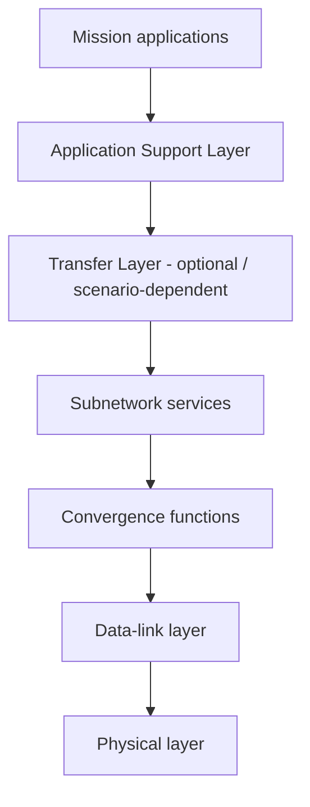

# SOIS layers and OSI mapping

## Layer roles

| SOIS element | Responsibility | Architectural purpose |
|---|---|---|
| User Applications | Mission-dependent application logic | Uses services without binding directly to device and bus details |
| Application Support Layer | Common onboard services | Offers reusable capabilities across processing nodes |
| Transfer Layer | Network and transport functions, where needed | Provides communication protocols such as IP, SCPS, or Space Packet Protocol where the architecture requires them |
| Subnetwork Layer | Access to a subnetwork and its service interface | Hides details of the underlying data-link implementation |

The Transfer Layer is not necessarily required in every communication scenario. The exact protocol stack depends on the mission architecture and selected interfaces.

## Conceptual layering

The diagram is conceptual. It should not be read as a claim that every implementation contains every layer or that each SOIS service maps one-to-one to an OSI layer.

## Relationship to OSI

SOIS uses service-oriented abstractions tailored to spacecraft onboard interfaces. The comparison with OSI is useful for orientation, but the models have different scopes and should not be treated as interchangeable protocol stacks.

- Subnetwork services abstract selected capabilities of the underlying link technology.
- Convergence functions can provide missing functions when the data-link technology does not natively expose a required service.
- Application Support services provide higher-level reusable functions to mission applications.

## Verification note

Confirm layer names, normative requirements, and mappings against the applicable CCSDS SOIS architecture and service publications. The mapping presented here is an explanatory model, not a conformance statement.
