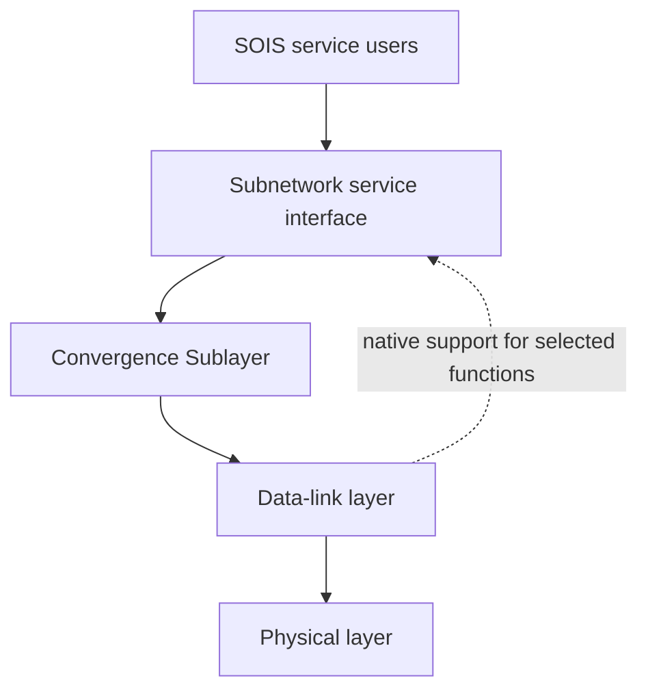

# SOIS Subnetwork

The SOIS Subnetwork provides a common service interface above heterogeneous onboard data-link technologies.

## Conceptual structure

The source analysis describes a structure containing a Convergence Sublayer and lower-level link and physical capabilities. The Convergence Sublayer supplies functions that are not provided natively by a selected data-link technology.

A function may be implemented by the underlying data-link technology or supplied through convergence functionality. The allocation depends on the technology and the service requirement.

## Service groups

| Group | Representative services |
|---|---|
| Packet | Packet Service |
| Parameter | Get Parameter, Set Parameter |
| Location / memory access | Read Location, Write Location |
| Time distribution | Time Distribution Service |
| Device discovery | Device Discovery Service |

Terminology and grouping should be validated against the specific CCSDS service specification edition used for a conformance assessment.

## Design considerations

- Avoid exposing link-specific details to higher-level service users.
- Identify which required functions are already supported by the selected data-link technology.
- Add convergence functionality only where needed.
- Document the service access points and their availability to users.
- Record technology-specific assumptions separately from the abstract service contract.

## Verification boundary

This page presents a conceptual synthesis of the study notes. It is not a normative implementation profile or a complete mapping for any particular spacecraft bus.
