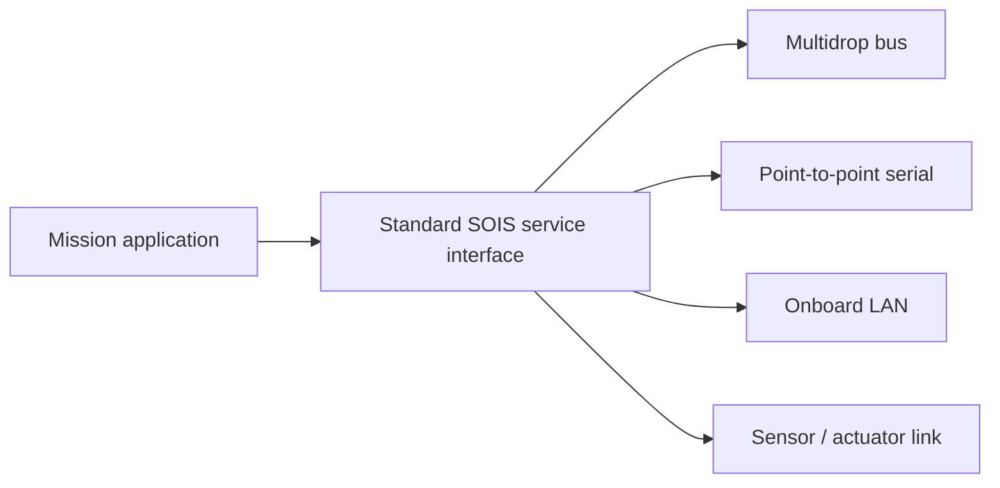

# Onboard interface topologies

The physical interface selected between spacecraft elements depends on communication characteristics, device capabilities, and system constraints. SOIS aims to keep mission applications from depending directly on those physical details.

## Interface categories

| Interface type | Typical arrangement | Architectural consideration |
|---|---|---|
| Multidrop bus | One bus shared by a controller and multiple connected units | Often asymmetric; endpoints may have different roles and capabilities |
| Point-to-point serial | Dedicated serial link between two endpoints | Commonly used for command/control and, where suitable, data transfer |
| LAN | Network connecting peer-capable processing nodes | Supports communication between nodes with comparable processing capabilities |
| Point-to-point sensor/actuator | Direct connection to a sensor or actuator | Often focused on reading measurements or writing control values |

## Topology abstraction

The diagram illustrates the abstraction goal; it does not prescribe a physical network design.

## Analysis questions

For each interface, an architecture description should identify:

1. Which node controls or initiates communication?
2. Is communication symmetric or asymmetric?
3. Which data-transfer and device-access functions are available?
4. Which QoS characteristics are supported by the link?
5. Which functions must be provided by convergence logic or higher-level services?

Concrete bus capabilities and protocol mappings must be verified against the applicable interface standards and mission-specific design.
