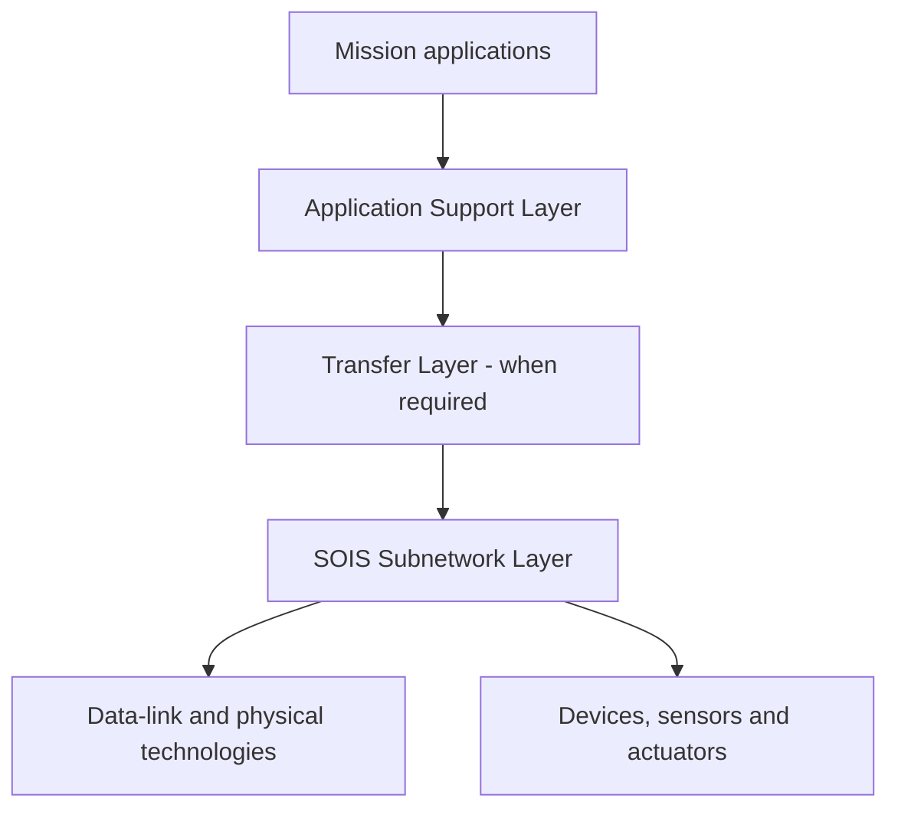

# SOIS Onboard Interface Architecture

**System analysis and architecture of spacecraft onboard interface services (CCSDS SOIS)**

This demonstration project examines how a standardized set of onboard services can separate mission applications from the details of spacecraft communication interfaces, network topology, and device-specific access.

## Architectural question

How can an application use onboard communication and device capabilities without depending directly on the underlying bus, link, or physical interface?

SOIS addresses this separation through service interfaces at different architectural layers.

## In this project

- **Architecture:** SOIS layers, their relationship to OSI concepts, and the role of the Subnetwork.
- **Interfaces:** multidrop buses, point-to-point serial links, LANs, and sensor/actuator interfaces.
- **Services:** Application Support and Subnetwork service groups.
- **Dependencies:** a service matrix showing conceptual relationships between service groups.
- **QoS:** delivery classes, priority, channel reservation, and an identified terminology question.

## Core architectural idea

Mission applications interact with standardized service interfaces rather than directly encoding the characteristics of every physical connection. This supports portability and reduces coupling between application logic and onboard communication implementation.

## Project status and limitations

This is a demonstration analytical project based on a study of SOIS concepts. It is not a flight-software implementation, a spacecraft deployment design, or evidence of hardware integration or testing.

The source notes include interpretations and questions that require checking against the exact applicable CCSDS publication editions. Pages distinguish architectural explanation from points requiring normative verification.
