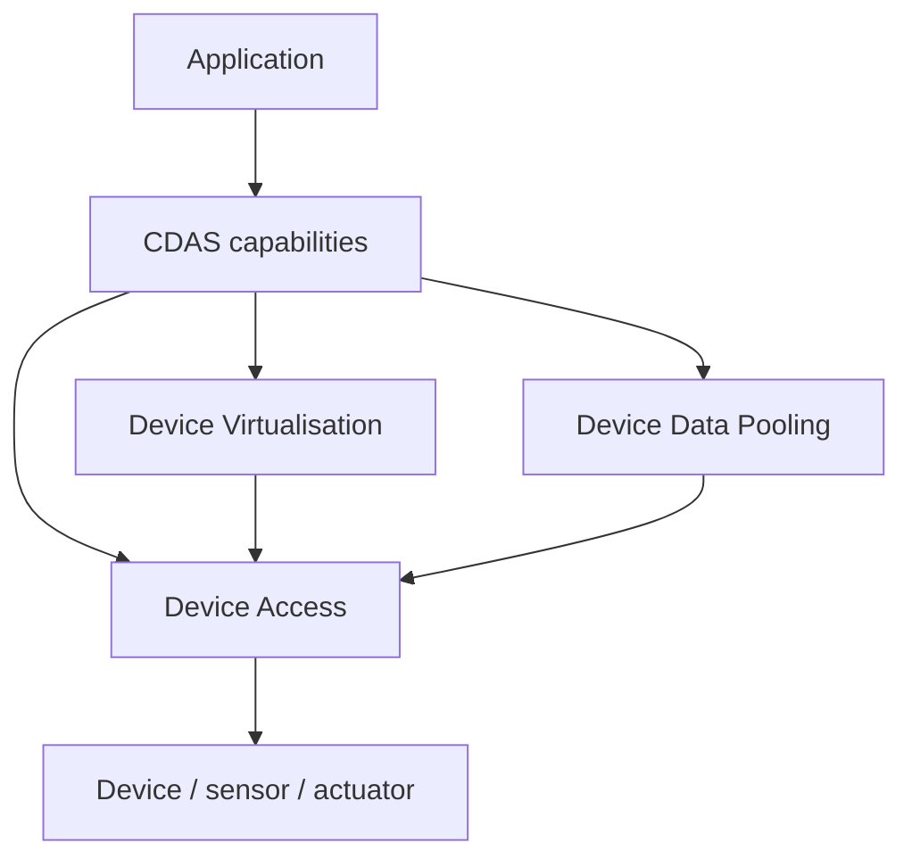

# Application Support services

The Application Support Layer provides common onboard capabilities to mission applications. Its purpose is to reduce dependence on the location of devices, the onboard topology, and the details of the communication implementation.

## Service catalogue

| Service | Abbreviation | Purpose |
|---|---|---|
| Command and Data Acquisition Services | CDAS | Access to sensors and simple devices for command and data acquisition |
| Time Access Service | TAS | Access to a local time source correlated with the onboard time reference |
| Message Transfer Service | MTS | Exchange of discrete messages between onboard applications |
| File Services | FS | File management and transfer in the onboard environment |
| Device Enumeration Service | DES | Support for discovery/enumeration scenarios and future plug-and-play concepts |

The exact status, scope, and normative requirements of each service must be checked against the relevant CCSDS specification. In particular, the study notes describe DES as an area whose definition was not available in the source material reviewed.

## CDAS decomposition in the study notes

The notes distinguish three conceptual capabilities:

- **Device Access Service (DAS):** basic device-dependent read/write access while hiding the device's physical location and electrical interface from the service user.
- **Device Virtualisation Service (DVS):** presents a common virtual representation of a physical device or device class.
- **Device Data Pooling:** maintains a shared data image/pool so multiple consumers can read device state without independently issuing identical acquisition requests.

This decomposition reflects the study material and should not be interpreted as a definitive normative service breakdown without checking the applicable publication.

## TAS and time distribution

TAS provides an application-facing interface to a local time source. Distribution and correlation of time across nodes are separate lower-level concerns; the study notes associate cross-node distribution with the Subnetwork Time Distribution Service.

## MTS and FS

MTS supports message-based communication between onboard applications. FS provides file-oriented capabilities and may rely on a network file access protocol or a dedicated file-delivery mechanism, depending on the architecture.

## Design questions

- Which services are mandatory or optional in the selected SOIS profile?
- Which service access points are exposed to each application?
- How are timing accuracy, message latency, and file-transfer behavior specified?
- Which service dependencies are direct and which are indirect?
