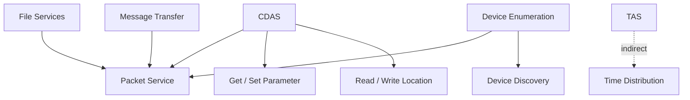

# Service dependency matrix

This matrix summarizes the conceptual relationships recorded in the study notes. It is intended as an analysis aid, not a normative dependency table.

| Application Support service | Subnetwork capabilities referenced in the notes |
|---|---|
| CDAS | Packet Service; Get/Set Parameter; Read/Write Location |
| TAS | Packet Service and Time Distribution (indirect relationship) |
| FS | Packet Service |
| MTS | Packet Service |
| DES | Packet Service; Device Discovery Service |

## Dependency view

## Interpretation

- A relationship indicates that a higher-level capability may rely on a lower-level service.
- An indirect relationship should not be represented as a direct service invocation without evidence.
- The matrix does not define call sequences, protocol bindings, or mandatory implementation requirements.

## Validation required

The source notes use some abbreviated or generalized service labels (for example, “Get/Set Service” and “Memory Read/Write Service”). Confirm the exact service names, dependency rules, and required/optional status against the applicable CCSDS service specifications before using this matrix for conformance or implementation planning.
